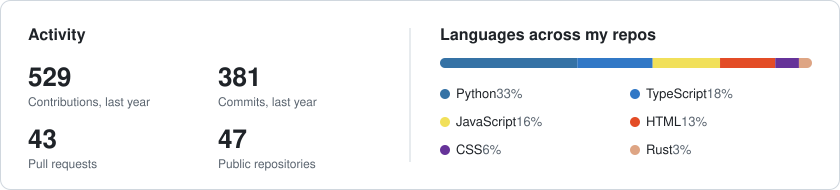

# Hi, I'm Samarth Jaiswal 👋

**I build software that shows its work: a compiler, a black-hole ray tracer, a consensus simulator, real-time collaboration, audio analysis and computer vision, most of it running right in the browser.**

- 🧠 **Systems and languages:** a compiler to WebAssembly, a Raft consensus simulator, a Rust physics engine, a Zig CSV profiler built on streaming sketches, an OCaml SQL lineage analyzer, all tested with fuzzing
- 🎨 **Graphics and sound:** WebGL2 ray tracing, canvas rendering, Web Audio synthesis and real-time sound analysis
- 🧍 **Computer vision:** pose detection and exercise tracking with MediaPipe, in Python and entirely in the browser
- 🌐 **Full stack:** React, Next.js and Vue/Nuxt in front; Node.js, Go, FastAPI, Flask and Spring Boot behind them
- 🤖 **AI apps:** Gemini and LLM-powered tools for documents, data and video

## 🚀 Featured projects

<table>
  <tr>
    <td width="50%" valign="top">
      
      <h3><a href="https://github.com/SAMARTHJAISWAL/vivar">vivar · कृष्ण विवर</a></h3>
      A black hole ray-traced live in WebGL2: every pixel follows a light ray through curved spacetime. Add spin and the shadow turns into the D shape of a Kerr black hole, matching Bardeen's curve to within a pixel.  
      
      <code>WebGL2</code> <code>GLSL</code> <code>General relativity</code>
    </td>
    <td width="50%" valign="top">
      
      <h3><a href="https://github.com/SAMARTHJAISWAL/lipi">lipi · लिपि</a></h3>
      A small programming language whose compiler, written from scratch, turns your code into real WebAssembly in the browser, showing tokens, typed tree, WebAssembly text and bytes. 20,000 fuzzed programs agree with a reference interpreter.  
      
      <code>Compilers</code> <code>WebAssembly</code> <code>Fuzzing</code>
    </td>
  </tr>
  <tr>
    <td width="50%" valign="top">
      
      <h3><a href="https://github.com/SAMARTHJAISWAL/sahmati">sahmati · सहमति</a></h3>
      An interactive Raft consensus simulator: crash servers, split the network and watch leader election and log replication one message at a time. Fuzzed against Raft's five safety properties over 120,000 runs.  
      
      <code>Distributed systems</code> <code>Raft</code> <code>TypeScript</code>
    </td>
    <td width="50%" valign="top">
      
      <h3><a href="https://github.com/SAMARTHJAISWAL/dhool">dhool · धूल</a></h3>
      A falling-sand physics sandbox: sand, water, oil, fire, lava, acid and ice reacting to each other. The simulation is a Rust cellular automaton compiled to a 36 KB WebAssembly module with no dependencies.  
      
      <code>Rust</code> <code>WebAssembly</code> <code>Simulation</code>
    </td>
  </tr>
  <tr>
    <td width="50%" valign="top">
      
      <h3><a href="https://github.com/SAMARTHJAISWAL/rangoli">rangoli · रंगोली</a></h3>
      A Diwali rangoli board you share with a link and draw on together in real time, with mandala symmetry and diyas that light the board at night. Peer to peer over WebRTC, kept in sync by a hand-written CRDT.  
      
      <code>WebRTC</code> <code>CRDT</code> <code>Canvas</code>
    </td>
    <td width="50%" valign="top">
      
      <h3><a href="https://github.com/SAMARTHJAISWAL/patakha">patakha · पटाखा</a></h3>
      Your phone as a Diwali cracker noise meter: live A-weighted decibels, a spectrogram, and every bang, ladi and rocket detected as it goes off. Audio never leaves the device.  
      
      <code>Web Audio</code> <code>DSP</code> <code>AudioWorklet</code>
    </td>
  </tr>
</table>

## 🧰 More projects

| Project | What it is | |
| --- | --- | --- |
| [**aavedan · आवेदन**](https://github.com/SAMARTHJAISWAL/aavedan) | A job search that finds roles in India, remote and worldwide, ranks them against your resume with Claude, fills each application in Chrome, reads every answer back, and sends only what you approve. | [Live demo](https://samarthjaiswal.github.io/aavedan/) |
| [**vansh · वंश**](https://github.com/SAMARTHJAISWAL/vansh) | Column-level lineage for SQL and dbt in OCaml: traces every column through CTEs, joins and `SELECT *` back to its sources, answers "what breaks if I change this column?", and runs in the browser via js_of_ocaml. Parses 346 real-world dbt models with zero errors. | [Live demo](https://samarthjaiswal.github.io/vansh/) |
| [**parakh · परख**](https://github.com/SAMARTHJAISWAL/parakh) | A CSV profiler in Zig: one pass and a few MB of memory for files of any size, with types, nulls, distinct counts (HyperLogLog), quantiles (KLL), top values and data-quality warnings. About 4× faster than pandas on 1M rows; the live demo runs it in your browser via WebAssembly. | [Live demo](https://samarthjaiswal.github.io/parakh/) |
| [**RepCount**](https://github.com/SAMARTHJAISWAL/repcount) | A workout rep counter that runs in the browser: on-device pose tracking counts squats, push-ups, curls and jumping jacks, with form cues. | [Live demo](https://samarthjaiswal.github.io/repcount/) |
| [**linkly**](https://github.com/SAMARTHJAISWAL/linkly) | A self-hosted URL shortener in Go with privacy-first click stats; the live demo is the real Go code compiled to WebAssembly. | [Live demo](https://samarthjaiswal.github.io/linkly/) |
| [**Raga Explorer · राग दर्शन**](https://github.com/SAMARTHJAISWAL/raga-explorer) | 25 Hindustani ragas with a synthesised tanpura, aroha and avaroha playback, a swara wheel and a raga clock, all generated with Web Audio. | [Live demo](https://samarthjaiswal.github.io/raga-explorer/) |
| [**CAT Quant PYQ Bank**](https://github.com/SAMARTHJAISWAL/cat-quant-pyq-bank) | 656 CAT Quant previous-year questions (2014–2025) by topic, year and difficulty, each solved step by step. | [Open](https://samarthjaiswal.github.io/cat-quant-pyq-bank/) |
| [**CAT VARC PYQ Bank**](https://github.com/SAMARTHJAISWAL/cat-varc-pyq-bank) | 642 CAT VARC questions from every slot of 2017–2025, each explained with the method and the trap. | [Open](https://samarthjaiswal.github.io/cat-varc-pyq-bank/) |
| [**ekagra · एकाग्र**](https://github.com/SAMARTHJAISWAL/ekagra) | A quiet listening room for deep work: sitar over an illustrated lamplit loop, with a focus timer. | [Live site](https://ekagra-mocha.vercel.app) |
| [**RealTimePoseDetection**](https://github.com/SAMARTHJAISWAL/RealTimePoseDetection) | Tracks 33 body landmarks from a webcam, video or image and classifies yoga poses in real time from joint angles. |  |
| [**celea**](https://github.com/SAMARTHJAISWAL/celea) | AI video generation: Gemini sharpens the prompt, Veo renders the clip, and an analyse-and-refine loop repeats until it meets the goal. |  |
| [**medical-imaging-platform**](https://github.com/SAMARTHJAISWAL/medical-imaging-platform) | A browser-based medical image viewer for PNG, JPEG and DICOM, with window/level and measurements, all client-side. |  |

## 🛠️ Tech I use

  
   
  

## 📊 GitHub at a glance

<picture>
  <source media="(prefers-color-scheme: dark)" srcset="https://raw.githubusercontent.com/SAMARTHJAISWAL/SAMARTHJAISWAL/output/stats-dark.svg">
  
</picture>

<picture>
  <source media="(prefers-color-scheme: dark)" srcset="https://raw.githubusercontent.com/SAMARTHJAISWAL/SAMARTHJAISWAL/output/snake-dark.svg">
  
</picture>

Stats and the snake are generated daily from public GitHub data by <a href=".github/workflows/profile-assets.yml">a workflow in this repo</a>.
